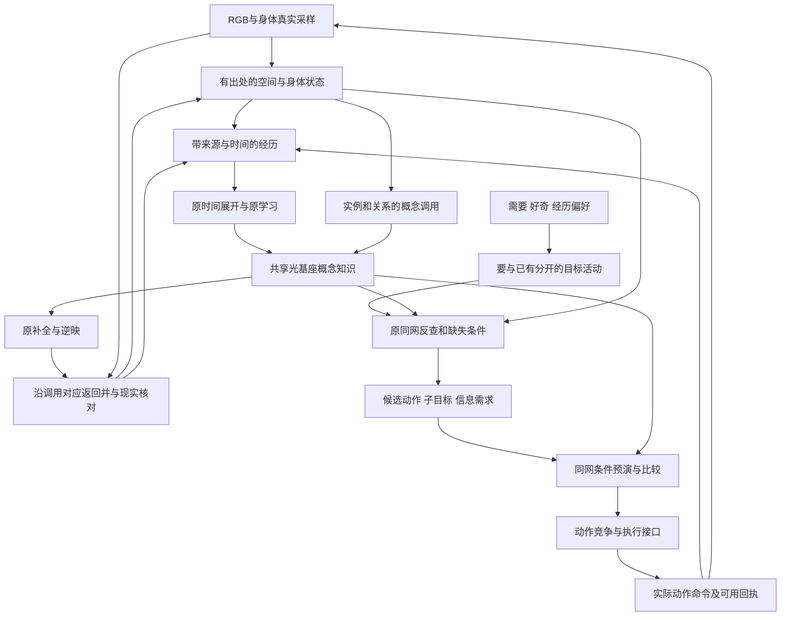

# 原光基座与状态网络闭环接线及能力缺口分析

原光基座继续承担学习、概念存储、规则抽象、事实校准、预测和同网目标反查。状态网络沿既有三维空间活动与多峰初设补齐当前情景、具体经历和活动状态；桥接使这些状态能调用原概念网络，并把补全、预期和缺失条件返回正确的实例、时刻与来源通道。

本轮结论是：已有基座给出了核心学习与推演路径；目前的主要缺口集中在输入表征、实例和关系绑定、跨位置调用、回映、来源与时间对齐，以及需要到执行的状态动力学。尚未发现足以要求更换原学习规则的最小矛盾。这里也没有把整条闭环判为已经理论完备或已经运行成功。

本文完成的是理论接线、条件能力分析、45项要求覆盖、38项稳定编号缺口和供网页 Astra Pro 的定向题包。任何新增承载方案仍需完成下文的方程、信息与纸上过程要求；没有编写原型、运行机制实验或安装环境。删除旧路线由母线程处理，本文没有删除资料，也不依赖旧错误路线的产物。

# 1 依据与设计边界

权威顺序是：本轮用户明确要求 → 原始期望能力中的用户决定与分期 → 两段原视频的具体机制 → 固定提交的历史源码参考。需求稿中早先“具体实现未定”“旧实现仅供参考”等宽泛措辞，不能覆盖最新的“保留原光基座学习规则、补状态与桥接”。实现候选、历史审查意见与 Codex 假设，不自动成为用户批准的机制。

“合法交互”仅指接口与环境允许执行的操作，不得预装针对未知事物的保护知识或保护规则。“不死亡”由环境条件落实，不能用预置危险识别、危险对象清单或规避策略代答。

原始资料：

- [状态模块功能图景 工作稿](https://chatgpt.com/space/page_bcf9ea1a418c8191b6095ca613b2911f)，本次读取保存序列8的全部114个正文块。
- [原光基座视频](https://chatgpt.com/api/library/files/libfile_339161d997048191b1e098851309cb89/download)，约4分49秒。
- [状态网络初设视频](https://chatgpt.com/api/library/files/libfile_4445b252ff8c81918d2a1781254e0e1e/download)，1分53秒。
- [bio-brain-v2 固定提交](https://github.com/vasily-tolkyov/bio-brain-v2/tree/142e8cf56461c053d533e5cb54445216e3e2f19b)，只用于辨认历史接口与版本差异，不作为新原型代码基座。

要求身份：U为用户已定，B为继承边界，N为本轮明确要求，C为Codex解释或假设。能力状态可以并列：**已有机制路径、条件成立、桥接缺定义、状态缺机制、原规则待澄清、未验证**。其中“已有机制路径”表示视频确实给出这条设计，不表示全部方程齐备；“未验证”不表示网络没有此能力。本文只对给定算子和给定信息证明局部限制，不作全架构不可能性断言。

所有知识形成继续经原光基座。状态与桥接不得另设固定内容核、关系势学习器、预置语义对象表、外置后果预测器或任务规划器来承担核心答案。传感器、时钟、动作接口、几何结构和活动隔离确有必要时，按第8节逐项公开，不通过命名隐藏先验。

# 2 受保护的原机制和状态初设

## 2.1 光基座

| 编号与原视频定位 | 已有机制 | 理论支持的范围 | 尚未展开或未验证 |
| --- | --- | --- | --- |
| L1，00:15、00:50、01:05 | 共闪增加连接ρ；单端活动衰减ρ | 反复共同出现的输入可增强共享通路，非共同成分可相对削弱 | 共闪时间窗、单端适用集合、更新频次、边界处理、传播诱发共闪是否学习 |
| L2，00:20–00:41 | 输入端口、局部对比、topK、峰值归一化；values[i]按索引映到神经元i，非最近邻 | 把数值输入送进原学习网络，保留指定输入索引 | 27端口与topK=6是演示值；不能直接当RGB、身体及多实例的最终编码 |
| L3，01:15–01:30 | 部分输入经原通道传播，形成已学模式补全；显示吸引子成员 | 内容记忆与由部分线索召回存在明确路径 | 正确补全率、未知拒绝、停止条件、吸引域与稳定性；画面accepted=True不是本轮实验结果 |
| L4，01:35–01:55 | ρ与色记忆H分轨；透过由t(ρ)和载色匹配决定；共享节点上的模式可分色传播 | 重叠模式的选择性传播和抑制串扰有原生接点 | 色记忆写入完整式、多色容量、合成与归一化、颜色自动来源；语义载色不自动等于实例ID |
| L5，02:08、02:15–02:45 | 活动按时间片展开、平铺、统一光色、再稀疏映射，用同类学习形成组合 | 有序经历可转成静态组合，复用原学习过程形成时序关联 | 时间分辨率、事件与持续状态、变速、跨片实例对应；统一色后何种区别还被保留 |
| L6，02:49–03:00 | 同一个补全吸引子逆映成H，与实际S在共同表示中相对照；差活动Δ不写past、不算执行 | 由已有知识得到预期并与事实比较；缺失内容可以显现 | 逆映是否为精确索引回放、部分解码或生成；观察掩码、时限和实际写入权限 |
| L7，03:05–03:45 | 红—按钮—灯与蓝—按钮—门，整体/局部模式随再经历加强或削弱 | 具体条件参与组合，反复事实可校准过宽或相竞争的局部关联 | 初始语义团不是已证明从RGB学出；交叉局部为何恰被减弱、如何归因仍需完整推导 |
| L8，03:55–04:45 | “要”通道认出目标→逐层补全→与低层“已有”求缺失；缺动作则竞争，缺非动作条件则再钳成子目标 | 同一知识支持目标反查和多层缺失条件分解，不需要另造规划知识库 | 目标实例化、候选顺序/环路/不可达、动作着地、竞争动力学、执行反馈与终止 |

符号避免混淆：视频“色记忆H”在本文记为H色；逆映光图样H记为H回。它们不因字母相同而成为同一种变量。外界RGB颜色、传播载色x、实例路由和事实来源也不能未经定义共用一个数。

原视频明确显示的连接更新是：

```math
\rho' = \rho + \eta(1-\rho)\quad\text{共闪}
\qquad
\rho' = \rho-\eta\kappa\rho\quad\text{单端}
```

01:35画面给出“t(ρ)=hill(q=4,h=1.5)”“match=Σ gaussian(x;w=0.05)”及“透过=t(ρ)·match(x)”。这些是核实到的画面参数与构件，**不能据此自行补出完整Hill函数、Gaussian归一化、边界、色记忆更新、色谱容量或传播时间步**。缺失部分保留为G01。02:15的统一光色也必须与L4共同解释，不能偷掉多实例绑定。

## 2.2 状态网络

| 编号与状态视频定位 | 已有初设 | 可支持的职责 | 仍缺的机理 |
| --- | --- | --- | --- |
| S1，00:03、00:11 | 先保留局部颜色、明暗、轮廓、原图位置与相对排列；没有物体或个体标签 | 为状态活动保留局部证据，避免先做成无出处概念集合 | 区域覆盖、弱特征保留、稀疏尺度、缺测表达 |
| S2，00:20、00:29 | 单图先约束视线方向；真实不同视角约束深度 | 允许三维位置候选和深度歧义 | 成像关系及匹配在演示中已知；对应、自运动、尺度与参照维护尚未求解 |
| S3，00:39 | 一物的角点/表面可形成多个空间峰 | 状态不是“一物强制一峰”；可先有未命名局部活动 | 多峰形成、保持、互抑/融合、归组与层级部分关系 |
| S4，00:49 | 局部特征及相对排列调用已学概念，两处共用同一概念但保留两份出处 | 跨位置共享概念和分实例调用是明确初设 | 如何得到可复用的输入线索，怎样编码并维持两份调用上下文 |
| S5，00:59、01:09 | 补全沿原对应回到原处，核对输入、修正对象范围与解释；证据不足保留未知 | 提供自下而上证据与自上而下补全之间的校正循环 | 回映的具体状态、归属竞争、误差分配和停止规则；缺角补全仍非观察 |
| S6，01:21、01:31、01:41 | 同一概念对应独立实例状态；只更新移动的一份；遮挡保留上次观察及来源 | 保持、局部更新与来源区分是原有设计要求 | 同色实例、交叉、分裂/合并、资源回收、身份多解及续接 |
| S7，01:49 | 观察、实际动作、随后结果带时间来源送概念；概念返学习结果、预测和缺条件 | 状态成为概念网络输入输出的环境接口 | 完整行动闭环和身体/需要/目标的活动接线 |

状态视频全程标“候选机理示意，非运行结果”，多处直接说明归组、绑定、更新和多峰保持待定义。本文继承这些设计承诺，不把动画运动当成动力学运行，也不把待定义抹成“没有初设”。

# 3 现基座在理论上已能支持到哪里

**学习与存储有清楚的局部机制。** 在固定的一对连接、给定有效共闪事件、0<η≤1且没有其他更新时，连续n次共闪得到ρ_n=1−(1−ρ_0)(1−η)^n。若仅发生单端事件且0≤ηκ≤1，则ρ_n=(1−ηκ)^nρ_0。这直接说明原公式能加强共同结构、削弱单端结构；不需要用另一个学习器解释这件事。这些取值是本段推导的成立条件，不是本轮批准参数。

若给定当前ρ后，每步共闪与单端事件的条件概率仍分别为常数p、q，且二者是互斥的有效更新事件，则条件期望漂移为η[p(1−ρ)−κqρ]，在p+κq>0时的均值动力学平衡点为p/(p+κq)。这是简化条件下的关联强度分析，**不是校准过的规则概率**；采样、门控和同一次经验被呈现几遍都会改变p、q。状态接口因此不能任意重放、漏记或重复呈现后仍宣称有效学习完全没变。

**概念抽象的接点已经存在，跨位置抽象的条件还需要桥接提供。** 原规则能从反复经验中保留共同结构；如果同类内容在新位置仍激活可对应的概念输入，已有权重就可能复用。若固定像素索引随平移整体换位、且没有任何变换关联、局部参照或跨位置经验连接，不能只由“有吸引子”推出未见位置泛化。这是输入对应问题，不是原公式没有学习能力。

**时间展开支持时序知识，但不能跳过时间和参与者。** 单独共闪是共现；视频已用展开补入先后。只要角色、时间片和持续状态仍可读，原组合机制有条件支持动作—后果预测。若两段经历在输入中变成同一向量，却要求不同输出，任何后续网络都不能恢复已经被抹掉的区别。

**同网补全、预测、事实校准和反查是同一组知识的不同使用方式。** 对它们分别约束问题入口：识别问“眼前可见线索对应什么”；预测问“给定当前条件和待试动作，随后可能怎样”；反查问“要达到这个状态，当前还缺什么”。这要求调用状态可区分，不要求三套知识模型。未知条件必须仍能表示未知；愿望不能成为预测成立的证据。

**当前不能从局部公式直接推出的结论**包括：任意多峰稳定、任意数量同类实例不串扰、正确无监督对象分组、因果方向唯一、长期记忆可无限保留、目标分解必达、永不循环和泛化正确。它们分别是信息、表示、动力学或验证缺口；后续须在有限条件下求解，而非否定或替换基座。

# 4 桥接方案的最低信息契约

这里提出可以交给Pro细化的接线方案：**状态网络保留具出处的空间活动；共享概念网络处理可复用线索；每次调用保有可返回的活动关系；事实、记忆、预测、目标与预演分清写入身份。** 这是最低信息契约，不是已经选定的外部对象表或程序路由器。下列符号只命名网络必须能够区分的信息，不要求每项独占模块、神经元或固定字段。

## 4.1 状态与调用必须能区分的内容

- 观察O：采样时刻、像素/身体通道、数值及可用性；零值、未看见与被删掉的稀疏项不能混为同一证据。
- 空间活动Z：位置候选及参照、局部特征、支持这些活动的观察。峰的个数、宽度和高度未必就是对象数、距离误差或置信度。
- 实例归属B：哪些活动暂被认为属于同一份出现；允许多解、未归属、整体/部分关系。它不是Minecraft真值ID，也不等于永久位置。
- 调用J：从哪份状态、哪些证据、哪个时间/参照、以什么目的进入概念网络，以及补全须回到哪个可分上下文。实例、候选身份和语义载色可有关联，但不能默认是同一个东西。
- 经历E：当时实际看见什么、尝试/执行了什么、后来实际看见什么，以及未确认部分。长期解释可修订，原始观察和动作发生记录不因重解释改成另一段历史。
- 活动目的M：现实识别、条件预测、目标反查、旧经历回忆、内部预演。它控制读出和写入资格；网络活动越强并不让假设自动变事实。

一种有效设计可以把上述区别编码在连续群活动、相位、临时绑定、组合节点或其他动态结构中。Pro必须指出每项实际由什么自由度承载，怎样读、怎样更新、何时释放，不能只返回这些名字。

## 4.2 跨位置调用与回映

设Z_b是某份候选实例的空间活动。桥接Φ把其中可复用线索送到原输入端口；r_b保留本次空间与时间对应。原网络以同一组ρ、H色传播得到补全c_b；R使用r_b把补全送回状态候选H回_b。新观察O参与核对，再调整B与对应关系。Φ、r、R都必须具体求解，本文不把符号当作实现。

对允许的位移或视角变化g，希望可复用内容满足Φ(gZ_b)与Φ(Z_b)足够一致，同时返回满足“随g到正确位置”。不能只做位置不变压缩而丢弃返回关系。对非对称外观、透视或遮挡，完全不变可能不成立，应保留多种局部参照或不确定性，而非强行归一到唯一姿态。

三种候选承载需由Pro比较，均不获自动批准：

| 候选 | 如何保留原学习 | 真实负担与反例 |
| --- | --- | --- |
| 在动态局部参照中呈现相对特征，绝对出处留在状态活动 | 原ρ与H色仍从这些线索学习；不冻结概念内容 | 局部原点、朝向、尺度和对象范围从何而来；对称物体无唯一朝向；归组尚未成功时不能假定已有物体坐标 |
| 依照同一概念权重的分相/分时调用，并保持独立状态上下文 | 多次查询共享长期通路；实例区别由调用活动保留 | 相位调度、并发容量、返回延迟、现实感知不中断；同一事件不能因两次调用变成两份事实 |
| 同网的上下文/组合活动支持并行调用 | 用既有组合与选择性传播承担上下文，而非复制永久概念库 | 色容量、混合规则和相互竞争是否足够；如果需新增多路传播变量，必须说明它相对原机制的改动 |

还可通过跨位置经历形成更高层共同模式，但这不能直接证明未见位置泛化，也不能取消实例返回关系。绝对色号不能作为可共享规律永久绑定的“这个实例”，否则新实例换色就可能失去旧知识。

## 4.3 必须满足的联合不变量

1. 两份相同类别同时调用时，概念知识共享，具体位置、属性、来源和调用结果可分别查询；内部临时标号换名不改变外部含义。
2. 甲移动只更新与甲有证据对应的状态；不能全局改写“滑块位置”后顺带挪动乙。
3. 旧调用返回时，要核对发起时的状态/对应是否仍有效；甲已移动或候选已分裂时不能把旧补全写进新占据旧位置的对象。
4. 预测和回忆可以调整当前解释与注意，不能直接写成新观察、新执行或新事实证明；想过一百遍不等于经历一百遍。
5. 时间片、关系角色和来源在上行、统一色、稀疏化及下行以后仍有足够的联合区别；仅保留它们各自出现过不够。
6. 一般目标、某个具体对象目标、需要达成的状态与当前已满足状态可分别表达；目标达到要由新观察或合法身体反馈核实。
7. 每次原学习更新的依据、配对、次数和适用集合可解释。保持ρ公式不变却任意改变样本组织或门控，仍可能改变有效学习机制，须公开登记。


# 5 从输入到执行闭环的逐段接线

下表描述信息如何穿过原机制。读写范围是必须实现的契约，不是已经存在的代码。“调用更新”指活动、对应与解释变化；“知识更新”只指进入原ρ/H色等已有学习过程。凡入口尚无具体编码，均标出缺口，不能用外部语义模块代答。时间调度必须最终落到G33；下表给出因果先后，未擅定毫秒数。



图中框是职责，不强制独立模块。预演分支和现实观测可交错运行，但不能把预演结果沿A→O伪装成环境反馈。

| 线 | 信号及来源 → 进入位置 | 读写和更新时间 | 必须保留的区别／缺口 |
| --- | --- | --- | --- |
| W01 | RGB及采样时刻→S1稀疏特征入口 | 读真实像素；本次采样写观察活动与可用范围 | 位置、通道、未观测/弱特征；不得输入对象真值；G02 |
| W02 | 稀疏特征与不同视角线索→S2/S3空间活动 | 每次新证据约束位置候选；继续保持未解决方向/深度歧义 | 原点参照、自运动、对应、深度来源；G03/G05 |
| W03 | 空间活动与局部共同结构→候选归组 | 读峰与轮廓/共同变化；迭代写归属候选，允许未归属 | 一物多峰、多物相似峰、整体/部分；G06/G10 |
| W04 | 实例局部特征与相对关系→L2原数值输入端口 | 发起调用时生成输入活动，保留对应关系；不预先写概念标签 | 跨位置内容如何对齐、实例/角色如何可分；G07/G08/G11 |
| W05 | 原端口活动→L1/L4学习和传播 | 事实呈现时按已核实的原规则更新；查询时只读还是会诱发学习，需G01/G13明确 | 直接输入与传播补全、共闪与单端、每份经历更新次数 |
| W06 | L3补全→L6逆映→S5原空间出处 | 本次调用完成后写“候选解释/补全”，经对应回到实例；返回前核验对应有效性 | 不写为新观察；不把已失效返回写到另一实例；G09 |
| W07 | H回与当前真实O/S→核对与归组修正 | 只在同参照、同相对时间及可观察部分比较；即时修正当前解释 | 未观测/不可见不能当反例；可观察区域的明确缺失可作候选反例，范围由G16判定；补全不是观察；G09/G13/G15 |
| W08 | 身体数值、实际改善/恶化→状态与经历 | 身体采样更新；作为可原生具备的感觉送原网络形成关联 | 饥饿强弱不直接包含“食物”或满足方法；G04/G19 |
| W09 | 教师或自主发出的原动作→动作经历入口 | 发出时登记尝试；若有回执再登记接口接受/执行状态；结果在后续观察中写 | 命令、执行、成功三者不合并；持续按住与新按边沿不同；G04/G27 |
| W10 | 前状态＋动作经历＋后观察→L5时间展开 | 以真实采样/动作时刻构造有序经历，再送原组合学习；时长/未确认保留 | 时间片、实例、关系角色、变化与持续状态；G11/G12/G14 |
| W11 | 当前条件＋未执行候选动作→L5/L3/L6条件预测 | 读同一知识，查询后续相对时间片；写预测活动及可核对期限 | 对象、候选分支、预测时间、未知/无变化；候选动作不进入现实past；G15 |
| W12 | 到期的预测与实际反馈→L7事实校准入口 | 新事实到来或核对期限到达后，形成正确条件下的原规则学习材料 | 不另设误差学习器；反例作用范围、无观察不作失败、旧经历不重复加证；G14/G16 |
| W13 | 具体经历→长期痕迹；当前状态/目标→按需回忆 | 重要经历形成可保留痕迹；被线索唤起时读旧经历，写回忆活动 | 事实、原解释、后解释、记忆缺失和猜测区分；G17/G18/G30 |
| W14 | 身体需要、未知、学习所得偏好→“要”通道 | 当前需要变化或探索机会形成时更新目标候选与优先活动 | “想要”、迫切程度、兴趣、外界规律可信度分别可读；G19/G20/G21 |
| W15 | 目标＋当前已有状态→L8上行补全与差集 | 对该目标实例反查；写缺失条件，不写“已拥有” | 同类目标与特定对象目标、当前已有与过去曾有；G22 |
| W16 | 非动作缺失→原“要”入口再次反查 | 递归产生子目标活动并保留父目标依赖；实际条件变化后重核 | 不能把缺件集合当已排序可执行计划；环路、冲突、不可达；G23 |
| W17 | 多种候选动作/子目标→同网预演 | 使用隔离的假设状态读原知识；只写该分支预测，定期接收现实更新 | 多分支不混合；现实变化可撤销过时分支；G24 |
| W18 | 候选后果差异及信息缺口→信息目标/行动偏好 | 提出能区分当前解释的观察或尝试，再经原目标反查接动作 | 不能预置正确鉴别动作；观测不可达与确有信息区分；G25 |
| W19 | 已着地的动作候选＋迫切性/目标进度→原动作竞争 | 保留当前实例、方向、持续时间候选；胜出后才送接口 | 候选叶如何对应原始玩家操作、互斥和同时按键、释放与中止；G26 |
| W20 | 接口执行→真实结果→W01/W08/W09 | 执行后继续采样；只在收到真实信息后更新状态、目标满足和原学习 | 延迟、阻挡、命令失败、只执行半段、无变化；G27 |
| W21 | 目标投入与真实有用进展→耐心/暂停/恢复 | 持续投入消耗；新有用信息可递减地补充；阈值触发重选 | 目标进展不是任意新奇，重选仍服从迫切性；G28/G29 |
| W22 | 已记疑问、暂停目标、新条件→再次唤起 | 不冲突疑问暂存；合适空闲或相关变化后恢复 | 空闲调查具体疑问属于V1；不等于二阶段系统巩固；G28 |
| W23 | 记住的地点与沿途线索→当前空间状态及子目标 | 饥饿唤起经历，按已学动作与地标逐步返回；到达后重新观察 | 记忆地点不是全知导航；食物已不在时必须修正；G31 |
| W24 | 背包/工作台画面、动作与结果→同一状态/经历/概念链 | 界面切换时更新参照与可见状态；尝试后形成真实经历 | UI位置、手上/世界物品对应与配方均不能免费给定；G32 |

**闭环的最小时间顺序**是：取得真实样本 → 更新当前证据与来源 → 维持/修订状态候选 → 调用原概念网络 → 收回补全或预期 → 对齐事实核对 → 给原学习提供有效经历 → 更新目标和候选 → 竞争后实际执行 → 等到真实反馈再次进入。内部预演可插在调用与竞争之间；它没有权力替代“等到真实反馈”。

“发生过一次”与“此状态仍然成立”必须分开。长按按钮的连续画面不是多次按下；上次看见食物不等于现在仍在；行动命令送出不等于成功；新学会一个共同规律也不等于所有支持它的具体经历可以删除。

# 6 全部已识别缺口

以下G编号固定于本次新分析，不沿用旧报告的同名编号。P0是必须先澄清的承载/语义基础，P1是V1闭环所需，P2是V1联合能力与规模约束，P3为已确定后续分期。P2不表示可以从V1删除。每项都要求原网络内可读状态和实际动力学，不接受“交给管理器”作为回答。

## 6.1 基座 输入 状态与核心桥接

| 缺口／优先／状态 | 需要补齐的具体内容与依赖 | 最小反例与纸上验收 |
| --- | --- | --- |
| G01 原机制规格，P0，原规则待澄清 | 补全ρ更新触发、H色写入、传播、读出、层间变换与校准的确切定义；不得混入源码钙迹变体。无前置 | 同一画面同一标记，若两种合理更新次序产生不同权重，必须指明采用哪种及证据；逐步写一次训练、一次纯查询、一次反例的所有变化 |
| G02 感觉稀疏化，P0，桥接缺定义 | 保留位置、弱区域、RGB/亮度及观测覆盖；依赖G01的原入口 | 两图topK相同但弱物体不同；须说明保留/丢弃什么，不宣称逆映能恢复未保留事实 |
| G03 三维参照与深度，P0，状态缺机制 | 单目方向、多视角对应、成像先验、自运动、漂移与尺度歧义；依赖G02 | 同一屏幕位移可由相机转动或物体移动造成；必须允许未知，不能从动作命令直接知道真实位移 |
| G04 身体与动作时序入口，P0，桥接缺定义 | 通道标定、采样时间、命令副本/回执/结果、教师带领；依赖G01 | 尝试前进但被挡住，不能学成已移动；长按三帧不能变成三次新按 |
| G05 空间多峰动力学，P0，状态缺机制 | 峰产生、维持、吸引域、分裂/合并、覆盖范围和未知质量；依赖G02/G03 | 两近峰不得因全局赢家机制必然并为一物；一物多角点也不能必然变多物 |
| G06 归组与整体部分，P1，状态缺机制 | 局部线索与概念回映共同修正边界，保留未命名区域、层级部分与分离来源；依赖G05/G09 | 树枝分离后，树继续可认、枝可单独操作、曾属于谁可回忆；禁止输入分割真值 |
| G07 跨位置概念入口，P0，桥接缺定义 | 固定位置线索怎样形成共享内容及新位置调用；局部参照/变换的取得与学习；依赖G01/G02/G05 | 同一形状平移后激活完全不重叠索引；须展示怎样仍用原知识，不能只换一个类别标签 |
| G08 多实例共享调用，P0，桥接缺定义 | 同一概念同时被多处调用时，承载、隔离、容量、调用次数与长期权重更新；依赖G07/G13 | 两同色同类物各有一属性，只改甲不改乙；临时标号置换不改变意义；不能复制成互不共享的永久概念库 |
| G09 逆映与返回对齐，P0，桥接缺定义 | 保留调用对应、空间变换、时间/来源和失效处理，定义与真实S比较的可观察区域；依赖G07/G08 | 发起补全后甲移动、乙占旧位；旧结果不能落到乙。只补虚缺角不能增加真实支持 |
| G10 身份续接及歧义，P1，状态缺机制 | 当前出现如何延续、终止、分裂、关联历史；遮挡多解与资源回收；依赖G05/G06/G08 | 完全同样物体在遮挡后交换，允许两解；新证据来后再修订，不能用内部ID制造知识 |
| G11 关系角色和抽象复用，P0，桥接缺定义 | 谁作用谁、相对何物、主体/受体/条件在空间与时间上联合绑定；依赖G07/G08 | “甲推乙”与“乙推甲”拥有相同边缘概念；编码必须不同，且换新实例仍能用学到的关系 |
| G12 时间展开中的状态与事件，P0，桥接缺定义 | 持续、起止边沿、实际间隔、跨片对应与层间统一色；依赖G04/G08/G11 | 在右端保持10帧与右移事件不同；A后B与B后A不能相同；改变速度不能被默默解释成无关规则 |

## 6.2 事实校准 具体经历与同网推演

| 缺口／优先／状态 | 需要补齐的具体内容与依赖 | 最小反例与纸上验收 |
| --- | --- | --- |
| G13 来源与写入资格，P0，桥接缺定义 | 现实、缺测、记忆、预测、目标、预演各自活动与写入权限；原机制何处已有隔离、何处需补；依赖G01/G04 | 断开动作接口，只反复想成功，past及已执行不增加；目标不能把未见结果写成现实 |
| G14 经验呈现与重复计数，P0，原规则待澄清＋桥接缺定义 | 同一经历多次检索、多处调用、不同采样率和显著性如何影响原学习事件流；依赖G01/G12/G13 | 一次真实经验回忆100次不能自动等于100次独立外界证据；多个实例并发更新共享边，须给顺序/次数而非只说公式未改 |
| G15 条件预测与核对时限，P1，已有路径＋桥接缺定义 | 固定当前条件/待试动作，读取对应后续片，表达无变化、未知及结果时间窗；依赖G09/G11/G12/G13 | 相同起态与候选动作只改变愿望，客观预期不应变成所愿；遮住结果不应立刻判错 |
| G16 条件差异 调查与校准，P1，已有路径＋原规则待澄清 | 失败指向哪些条件/关系；怎样调查差异、削弱无解释规则、保留未解释经历并原机制修订；依赖G11/G14/G15/G17 | 左右条件下按键后果不同，不能只全局削弱“按键”；随口生成新原因不能永久保护旧规则；须显示原ρ事件怎样改变 |
| G17 具体经历长期保留与回忆，P1，状态缺机制 | 一般规律和具体发生分开保留，重要性、检索、概要/遗忘、缺失标识；依赖G10/G12/G13 | 学会食物规律后仍能记住在哪里、对哪份对象做过什么；不能统一“巩固后删除所有经历” |
| G18 重解释及派生判断修正，P1，状态缺机制 | 原观察与后来的对象/因果归属分层；修正传播到相关判断、目标和条件知识；依赖G10/G16/G17 | 把甲误认乙后纠正，历史实际像素/动作不变，错误归属及由此得出的计划须可修正；无需预定某种日志表 |
| G24 预演并行与现实中断，P1，状态缺机制 | 同网多候选状态隔离、展开深度、现实采样调度、分支失效与恢复；依赖G13/G15/G23/G33 | 思考取物时物体被移走，现实更新能中断旧分支；失败分支不污染另一分支和事实 |
| G25 主动获取信息，P1，桥接缺定义 | 比较候选预期的可观察区别，产生信息目标并经原反查找到动作；依赖G15/G20/G23/G24 | 两解释只在换视角后不同，不能永远重复原视角；无法区分时承认当前信息无效，不预置正确探测程序 |

## 6.3 需要 目标 动作与自主调节

| 缺口／优先／状态 | 需要补齐的具体内容与依赖 | 最小反例与纸上验收 |
| --- | --- | --- |
| G19 身体需要形成目标，P1，状态缺机制 | 原生需要/改善恶化信号如何驱动“要”；满足方法怎样由原经验关系学得；依赖G04/G13/G17 | 初次饥饿不可直接知道哪个物件能吃；经历改善后才形成可用目标反查 |
| G20 好奇与未知探索，P1，状态缺机制 | 未解释区域、不确定条件、新线索如何持续产生目标和注意；依赖G06/G15/G28 | 没有现成概念或教师任务时仍可观察、尝试；不能只能重复最强已知吸引子 |
| G21 长期兴趣偏好，P1，状态缺机制 | 经验如何形成可持续可改变的探索倾向，区别需要、习惯与事实可信度；依赖G17/G19/G20 | 不同互动历史产生不同倾向，新经历可改变；很饿时不被兴趣永久劫持；不预设具体爱好 |
| G22 目标实例化与满足判据，P1，桥接缺定义 | “某类需要”与“这份对象/此位置目标”的着地；已有、曾有、想要和已达成区分；依赖G08/G09/G10/G19 | 想拿甲却见乙，不能自动满足；曾经吃饱不能清除现在饥饿；无观察不能仅凭预期宣布完成 |
| G23 同网反查与多步依赖，P1，已有路径＋状态缺机制 | 原差集的动作/非动作分支、父子目标依赖、候选竞争、顺序、环路和不可达；依赖G11/G12/G15/G22 | A需B、B又需A时不能无限反查；两个缺件互斥时不能并发当成可执行方案 |
| G26 动作竞争与接口着地，P1，桥接缺定义 | 原动作叶如何产生玩家操作、指向、时长与释放；竞争和组合的状态承载；依赖G04/G22/G23 | “接近物件”不等于已知道前进方向；教师仅执行动作；无语义动作答案，必须靠经历与当前状态选择 |
| G27 执行核对与延迟归因，P1，桥接缺定义 | 发出、接口接受、真实效果分别确认；中止、失败、迟到结果与原学习绑定；依赖G04/G12/G15/G26 | 计划三步只执行一步且效果提前出现，后两步不得写入成功历史；被挡住时不得自动推进目标 |
| G28 优先级 疑问 暂缓与恢复，P1，状态缺机制 | 迫切性、当前进度、非冲突疑问、暂停条件、新线索恢复与注意返回；依赖G17/G19/G20/G22 | 饿时中断探索但进度保留；短暂看一眼不丢任务；无冲突疑问先记后查；未知解法不等于任务不存在 |
| G29 耐心与有效进展，P1，状态缺机制 | 目标持续投入消耗、真实信息进展、递减刷新、阈值、迫切性重选；恢复规律仍为假设；依赖G16/G25/G28 | 排除未知办法可刷新，重复已知结果不可；同一目标多次刷新递减；切来切去不能免费获得无限耐心 |
| G30 状态相关记忆深度，P2，状态缺机制 | 编码时需要/关注影响留存与后续唤起，且区别于外界证据数；依赖G14/G17/G19/G21 | 饥饿时发现食物留下较深记忆，吃饱后差别可保留；更深不等于规则多了独立样本 |

## 6.4 联合能力 规模与后续分期

| 缺口／优先／状态 | 需要补齐的具体内容与依赖 | 最小反例与纸上验收 |
| --- | --- | --- |
| G31 记忆地点返回，P2，条件成立＋桥接缺定义 | 空间参照、地标回忆、已学动作及原目标反查接成返回链；依赖G03/G10/G17/G23/G26/G27 | 食物发现→离开→饥饿唤起→按已探索线索返回→核实是否仍在；不得传入真值位置或导航路径 |
| G32 背包 工作台与物品外观对应，P2，桥接缺定义 | 世界/手上/UI视角与活动对应、合法界面操作、自主尝试结果学习；依赖G02/G07/G11/G17/G26/G27 | 拾取后物品外观变化，关联来自经历；允许无配方尝试，不能预装合成答案 |
| G33 有限资源 稳定性与可读性，P0到P2，未验证＋状态缺机制 | 共享节点多路容量、实时调度、饱和/遗忘、概念干扰、停止/拒绝、证据可信度和活动读出；贯穿全部G项 | 加入第三实例/并发目标后旧两份不能悄然串写；资源不足明确未知/延期；强峰不能冒充高可信；尚无数值预算 |
| G34 环境与接口条件，P2，未验证 | 可用RGB/身体/原始操作字段；逐渐饥饿、进食缓解、不死亡的兼容配置；合法不等于预装未知危险保护知识；依赖G04 | 模式名称不能代替三个环境条件的实际成立；本轮按用户要求不安装、不配置 |
| G35 未来需要与长期安排，P3，条件成立＋状态缺机制 | 可选V1先做熟悉环境、单需要、短跨度预测；完整储备/远途/多需要/不确定未来仍保留后续；依赖G15/G19/G23/G24/G31 | 不把“未来将饿，所以先取食物”直接写成答案；短范围成功不等于长期安排已成立 |
| G36 主动回顾与系统巩固，P3，状态缺机制 | 二阶段空闲主动取回、跨经历联系、系统巩固；保留来源和证据计数；依赖G14/G17/G18/G30 | V1按需回忆不能被推迟；二阶段重放不自动创造独立事实或覆盖原始经历 |
| G37 语言 声音与成熟合成，P3，桥接缺定义 | V1后目标语言适配、听觉输入、说明来源/成熟合成；依赖原状态与目标接口 | 外部LLM只能在被批准范围转换目标，不能取代核心预测规划；V1不依赖这些输入 |
| G38 自身能力的系统认识，P3，状态缺机制 | 后续候选：熟练度、局限及能力认识；依赖G17/G18/G21/G27 | 一次动作效果学习不等于完整自我能力模型；不得反过来要求V1先具备自我评价 |

## 6.5 优先顺序与跨组冲突

先冻结G01的原机制边界，同时建立G02/G04/G13的最小真实样本契约；G03/G05明确空间活动能保留哪些证据。随后集中解决G07/G08/G09/G11/G12：共享概念、分实例调用、正确返回、关系角色和时间片。G14与G33必须从开始就参与，不能最后才发现多路调用把同一经历重复学习。

在此基础上接G15/G16的预测与事实校准、G17/G18的经历记忆，再接G19–G29的需要、目标、同网反查、预演、信息获取、动作执行及自主调节。G30–G34验证这些能力共同组成完整V1。G35–G38按原分期继续保留，不能替换V1已经承诺的预演和按需回忆。

特别需要联合求解的冲突是：空间归组依赖概念补全，而概念形成又依赖输入归组；多实例共享长期知识又必须隔离短期活动；预演要复用同一知识又不能生成事实；状态相关记忆要更牢固又不能凭深刻程度提高外界证据数；长时目标要保持又要能被现实和迫切需要打断。每处需要双向逐步过程，不能以模块各自合理替代联合自洽。


# 7 期望能力覆盖矩阵与纸上验收

下表覆盖需求稿全部功能与本轮边界。来源栏采用原Page的章节名；U/B/N/C见第1节。V1之外的能力另列，未悄悄删掉。所有“条件成立”的联合能力仍未运行验证；表中已有路径的构件依据L1–L8、S1–S7。

## 7.1 第一版及架构边界

| 要求 | 来源与身份 | 现有接点及当前状态 | 缺口与纸上验收 |
| --- | --- | --- | --- |
| R01 原生基本三维理解并持续修正 | 输入与学习起点，U | S2/S3；条件成立，状态缺机制 | G03/G05；T1 |
| R02 画面为依据，区分当前/上次观察/估计/未知 | 继承边界，B | S1/S6；桥接缺定义 | G02/G09/G13；T2/T9 |
| R03 身体需要、改善恶化、好奇和耐心 | 输入与学习起点，U | 可接L2/L8；状态缺机制 | G04/G19/G20/G29；T1/T4/T6 |
| R04 玩家合法动作接口；不预置未知危险保护规则；动作意义与效果由经历学习 | 输入与学习起点，U | L5/S7；桥接缺定义 | G04/G12/G26/G27；T1 |
| R05 教师仅带领执行，不给解释/答案/评价 | 输入与学习起点，U | 原经验学习可承接；条件成立 | G04/G13/G26；T1 |
| R06 区分并记住刚尝试的动作及随后结果 | 输入与学习起点，U | L5/S7；桥接缺定义 | G04/G12/G17/G27；T1/T3 |
| R07 环境保证活动饥饿、进食缓解、不死亡；不验死亡重生 | 输入与学习起点，U | 环境功能要求；未验证 | G34；T1环境前提 |
| R08 V1无声音，不依赖外部语言目标 | 范围与输入，U | 边界已定；自主闭环未验证 | G19/G20/G26/G37；T1/T4 |
| R09 陌生未分对象区域也可关注/观察/尝试，边界可改 | 对象与情景，U | S1/S3/S5；状态缺机制 | G05/G06/G20；T2 |
| R10 同类相似多个具体对象分别处理 | 对象与情景及出题草案，U；本轮N | S4/S6；桥接缺定义 | G07/G08/G09/G10；T2 |
| R11 整体/部分、分离后独立及来源记忆 | 对象与情景，U | 可由组合与S3接入；状态缺机制 | G06/G10/G17/G18；T2 |
| R12 遮挡身份不明保留多解、后来区分 | 对象与情景，U | S6；状态缺机制 | G10/G13/G18；T2 |
| R13 误认后修正归属/派生判断，保留实际经历 | 对象与情景，U | L7/S5；状态缺机制 | G16/G17/G18；T2/T3 |
| R14 回忆/预演时仍感知现实，相关变化可中断 | 对象与情景，U | 来源边界已有；状态缺机制 | G13/G24/G28/G33；T5 |
| R15 相似情景唤起经验，相关条件不限外观 | 预期与规则修正，U | L3/L5/L7；已有路径，桥接缺定义 | G07/G11/G15/G17；T3 |
| R16 新的相符经历加强预期，结果可修正预期 | 预期与规则修正，U | L1/L6/L7；已有路径，原规则待澄清 | G01/G14/G15/G16；T0/T3 |
| R17 预期落空主动找条件差异并调查 | 预期与规则修正，U | L6/L7/L8接点；桥接缺定义 | G16/G20/G25；T3/T5 |
| R18 无进一步原因则降低规则置信度并存未解经历 | 预期与规则修正，U | L1/L7；条件成立，状态缺机制 | G16/G17/G33；T3 |
| R19 规则随证据演变，旧具体经历可重新理解 | 预期与规则修正，U | L7接点；状态缺机制 | G16/G17/G18；T3 |
| R20 好奇与未知驱动自主探索目标 | 自主目标与规划，U | L8目标口；状态缺机制 | G20/G28；T4 |
| R21 身体需要驱动目标，满足方法从经历学 | 自主目标与规划，U | L5/L8；条件成立，状态缺机制 | G19/G22/G23；T4/T7 |
| R22 经历形成可变长期兴趣，影响选择且服从迫切需要 | 自主目标与规划，U | 原学习可承接；状态缺机制 | G21/G28/G30；T4 |
| R23 无教师/语言时仍自主活动 | 后续素材，C，为既有自主要求的联合验收 | 可接完整闭环；条件成立，未验证 | G19–G29；T1/T4 |
| R24 学得规律形成多步中间目标，途中调整 | 自主目标与规划，U | L8；已有路径，状态缺机制 | G22/G23/G27/G28；T5 |
| R25 行动前预演不同做法后果并比较 | 自主目标与规划，U | L5/L6/L8；条件成立，状态缺机制 | G15/G24/G26；T5 |
| R26 获取信息可成为中间目标，再继续规划 | 自主目标与规划，U | L6/L8；桥接缺定义 | G20/G23/G25；T5 |
| R27 不冲突疑问先记，完成当前目标后调查 | 自主目标与规划，U | 需状态保持；状态缺机制 | G17/G28；T5 |
| R28 更迫切需要打断并保留进度，注意转移能返回 | 自主目标与规划，U；旧方案取舍C | 需状态调节；状态缺机制 | G19/G24/G28；T4/T5 |
| R29 无进展暂缓，保留尝试/缺口/目前不会的判断 | 自主目标与规划，U | 需状态保持；状态缺机制 | G17/G28/G29；T6 |
| R30 新经验或条件变化可恢复暂缓目标 | 自主目标与规划，U | L3记忆唤起接点；状态缺机制 | G17/G28/G29；T6 |
| R31 持续目标投入消耗耐心 | 耐心功能，U | 视频未给具体规则；状态缺机制 | G29；T6 |
| R32 有用进展刷新；排除未知可算、重复已知不算 | 耐心功能，U | 事实校准接点；状态缺机制 | G14/G16/G25/G29；T6 |
| R33 同一持续尝试中刷新量递减 | 耐心功能，U | 视频未给具体规则；状态缺机制 | G29；T6 |
| R34 达阈值暂缓重选，仍服从迫切性 | 耐心功能，U | 目标竞争接点；状态缺机制 | G19/G28/G29；T6 |
| R35 即使规律学会仍保留重要具体经历 | 长期记忆，U | L5支持经历组合；状态缺机制 | G17/G30；T7 |
| R36 记地点/对象/动作结果/来源/疑问/中断目标并可用 | 长期记忆，U | S6/L5接点；状态缺机制 | G10/G17/G18/G28/G31；T7 |
| R37 相似状态唤起记忆，目标影响注意/回忆/尝试 | 长期记忆，U | L3/L8；条件成立，桥接缺定义 | G17/G22/G28；T5/T7 |
| R38 当时状态影响记忆牢固及持续，后来状态改变仍可留差别 | 长期记忆，U | 可接原学习和状态保持；状态缺机制 | G14/G30；T7/T9 |
| R39 饥饿唤起食物地点，循已探索线索返回再核实 | 长期记忆联合验收，U | S2/S6/L3/L8；条件成立，未验证 | G03/G17/G19/G23/G27/G31；T7 |
| R40 背包/工作台自由尝试合成并从结果学习 | 输入与学习起点，U | 同一输入经历链；桥接缺定义 | G32；T8 |
| R41 不预装配方用途，外观联系由经历；V1不要求完整成熟合成 | 输入与学习起点，C范围解释 | 原学习方向可承接；条件成立 | G07/G11/G32；T8 |
| R42 原光基座学习存概念、抽规则、事实校准、预测与同网反查 | 两侧联动及本轮，U/N | L1–L8；已有机制路径，原规则待澄清，未验证 | G01/G07/G12/G14/G15/G16/G23；T0 |
| R43 状态提供具体材料，概念返回解释/预期/条件/动作与目标；观察修正两侧 | 两侧联动，C/N | S7与L1–L8；桥接缺定义 | W01–W24；T0/T9 |
| R44 真实/记忆/估计/目标/预演有别，状态说明有运行依据 | 继承边界及功能启示，B/C | L6/L8/S6；已有边界，桥接缺定义 | G09/G13/G14/G18/G33；T9 |
| R45 仿真动态网络，三维多峰初设，避免固定表模板与替代学习器 | 用户原则及本轮，U/N | 继承约束明确；具体方案待解 | 全部G项及第8节；T0/T9 |

## 7.2 原分期与补充约束

| 阶段 | 保留能力与对应缺口 |
| --- | --- |
| V1必选 | R01–R45所定范围；包括长期兴趣、多步目标、内部预演、主动信息获取、按需回忆、具体疑问空闲调查与自由合成尝试 |
| V1可选扩展验证 | 熟悉环境、单一需要、较短跨度的未来需要预测与提前行动；G35 |
| 第二阶段 | 空闲主动回顾真实经历、发现跨经历联系、系统性巩固；G36 |
| V1后阶段未定 | 外部语言任务，原型学语言或外部LLM转换合适目标；环境声音、带说明的成熟合成；G37 |
| 后续完整能力 | 长期储备、远途准备、多未来需要资源分配、多个不确定未来的安排；G35 |
| 后续候选分期未定 | 系统认识自身能力、熟练度、局限；G38 |

仍属C或待设计：耐心暂缓后的恢复及防切换套利；无证据的新解释不永久保护旧规则；回忆/预演/深刻感受不制造外界证据；记忆压缩、遗忘与容量；可用身体接口；对象数、经历数、任务长度、遮挡/干扰、延迟、成功阈值等数值。完整情绪模型、主观熟练感、自我评价及特定练习加速率不是本轮新增V1门槛。环境安装配置仍暂缓。

## 7.3 十个联合纸上验收

每个验收列出：已有真实经历→本次允许输入→每步网络活动和原更新→候选/选择→实际执行和反馈→结果/未知→可能反证。它们是待走通的验收脚本，不是本轮已通过的实验。

| 编号 | 最小过程与判据 |
| --- | --- |
| T0 原机制贯穿 | 同一经历进入原ρ/H色、部分补全、时间展开、H回/S核对、目标反查、动作叶及真实反馈；每处新算子注明。如果核心知识由替代学习器或外置预测规划器提供，不满足边界 |
| T1 教师退出 | 只给RGB、身体与动作经历，先执行一种未知动作并观察；教师退出后根据需要/未知继续。不能在动作输入附送意义、因果答案或评价；环境三条件另行核实 |
| T2 两实例与部分 | 两同色同类对象分别调用；甲移动、乙不变；发起旧补全后位置改变；遮挡交换允许多解；整体部分分离保留来源；后来纠正误认而不改真实历史 |
| T3 条件改变 | 在两条件下得到相同动作的不同结果，条件交换与无关插入后重新预测；失败时调查、降不受支持置信度、存未解经历；不能只改名字或保住所有旧解释 |
| T4 自主与偏好 | 两段不同互动历史形成不同探索倾向，新经历可改变；随后提高身体需要，改变目标选择而不毁掉原目标进度；未预装食物或兴趣答案 |
| T5 多步与信息 | 一个目标有两条可能路线、一项关键未知；原反查形成中间目标、预演比较、主动观察后继续；现实变化中断旧分支，非冲突疑问先记后查 |
| T6 耐心 | 无进展→排除未知办法→重复已知结果→再次有用进展→阈值暂缓→仍饿时换来源→新条件后恢复；展示递减刷新，恢复律标C，禁止凭切换无限充满 |
| T7 食物地点记忆 | 发现食物→离开→吃饱/状态改变→以后饥饿→唤起具体地点经历→沿已探索地标与已学动作返回→核实食物仍在或已变；记忆深度与规则证据分开 |
| T8 自由合成 | 世界物件经拾取/取用进入手上及UI，外观联系由经历形成；未知合法操作可尝试、结果可保留；不给现成配方，不把成熟完整体系当V1要求 |
| T9 来源与资源联合 | 同一经历被反复回忆、多个实例调用和多分支预演时，无额外真实执行/事实；在有限容量内维持现实感知、局部更新、目标延续；不足时明示未知或排队 |

一个核心桥接的条件性纸上轨迹可先这样检查：时刻t0，两份局部证据形成b1/b2候选，均用相同概念知识，但保留各自r1/r2；t1补全返回，只在各自出处成为候选解释；t2只有b1的真实位置证据改变，更新r1与b1、维持b2；t3来自t1的旧r1返回需重核，不能覆盖新状态；t4两份被遮挡后只有一份出现，若观察不足保留多种对应；t5有区分线索后修订相关经历归属。这个轨迹明确需要什么信息，**尚不能替代G05–G10的实际动力学**。

# 8 先验 结构例外及有效学习审计

已有用户允许的是基本三维理解、身体需要和改善恶化感受、玩家动作接口；这不意味着批准所有几何算法、字段表或门控方案。下列均须对具体实现逐项解释，不自动否决通用结构，也不自动放行。

| 对象与候选 | 为什么需要 | 替代与通用性影响／待审点 |
| --- | --- | --- |
| 像素拓扑、通道尺度、采样时钟 | 输入必须有可区分来源和先后 | 可学多尺度特征，但传感器邻接/时间不是对象语义；明确哪些结构原生 |
| 成像关系、空间参照与局部归一 | 从方向/多视角线索建立可更新空间状态，支持跨位置调用 | 可比较已知标定与学习标定；不得偷带真值深度/世界坐标；对称和透视歧义影响泛化 |
| 多峰维持、竞争、归组约束 | 同时保持多份证据并防串写 | 相位、组合活动、局部竞争等均有容量和先验；不能硬接“某区域就是某物体” |
| 调用上下文、实例/关系绑定及返回关系 | 共享概念后仍知道属于谁、回哪里 | 可分相或并行活动，不能假定无限色值/槽位；新增传播自由度的影响须明确 |
| 时间角色与动作边沿 | 让原共闪机制获得有序材料 | 时间片、延迟或事件活动各有尺度限制；分时计算相位不能伪装为真实时间 |
| 现实/假设/目标的活动隔离 | 落实原Δ不写past、要不等于已有 | 不一定物理分网；新门控会改变有效学习事件，需要原机制一致性证明 |
| 未观测及有效呈现掩码 | 防止缺测被当反例、防止想象冒充观察 | 若只屏蔽某类单端衰减，就是学习适用域改变，须明确来源/必要性，不能说只是显示标记 |
| 参数共享与多实例更新调度 | 复用知识同时服务多个实例 | 共闪次数、衰减顺序和聚合决定结果；必须比较而非悄悄平均 |
| 原始动作接口、回执、资源上限 | 对环境执行可识别操作并承认失败/延迟 | 接口可列合法操作，不可列每种未知对象的动作含义、路线或成功步骤 |
| 需要到目标、耐心与偏好调节 | 用户明确要求自主行为与持续调节 | 需要和基本感受可原生，具体食物/爱好/策略不可；若改变ρ学习率或样本权重，须列为原规则影响而非默认 |

一个不可忽略的代数检查：令F+(ρ)=(1−η)ρ+η，F−(ρ)=(1−ηκ)ρ，则F+∘F−−F−∘F+=η²κ。多个实例对同一连接同时提供加强与衰减时，处理次序本身会改变结果。连续k次共闪的有效强化率是1−(1−η)^k。故“公式没变”不足以保证原有效学习过程没变；对共享、分时、重放、掩码、归一化必须同时审计。

有序共现支持条件预测，但反查出的伴随动作不自动成为因果充分条件。若环境因素同时引起动作和结果，单凭时序相关不能排除它。G16/G25/G27要利用自身尝试与结果核对，并保留未排除解释；不能把“反查到动作”升级成“保证该动作能达成目标”。

# 9 供网页 Astra Pro 的完整定向题包

以下为可直接随本文件提交的请求；本轮未代为提交网页。

请基于本文第1–8节及第10节原始资料，求解原光基座和状态网络的机制缺口。你不是重新选择学习架构：原共闪ρ更新、H色与传播、同网部分补全、时间展开、H回/S事实核对以及“要/已有”隔离与同网目标反查均为受保护基座。状态网络从空间活动/多峰、局部模式调用、沿对应回映、实例保持和局部更新的初设继续。请保持45项要求及全部分期，不把第一版缩成识别或单步行动。

不得以固定内容核、关系势替代学习、外置预测器/任务规划器、预训练语义标签、真值对象ID/坐标、现成配方或成功动作序列绕过问题。表格和符号可以用于解释设计，不得以外部语义表代替网络自身工作。只做理论求解，不要求先编码、安装或跑实验。

首先逐条复述L1–L8与S1–S7，区分视频明示、源代码历史变体、你的推导和新增候选；若无法实际查看视频，明确只使用本文的带时间转录，不声称观看。缺少完整方程时先给受约束的最小补充定义，标清哪些定义有原证据、哪些改变有效机制；不可暗选钙迹STDP覆盖视频。若认为非改原规则不可，必须给出：**在原规则明确条件下的最小矛盾、不能由状态/桥接解决的理由、最小改动、影响到哪些能力与已学知识、替代方案**，交用户决定，不直接实施替换。

请按下列十组完成，并保持G编号：

1. **Q1 原机制与更新事件流：G01/G13/G14/G33。** 列完整状态变量、域、原更新触发、传播、色记忆与读出；区分直接观察与网络补全；写一次训练/查询/反例中每项更新。专门分析共享边并发更新的次数和顺序、观测覆盖、重复回忆与预演资格。用代数说明你的隔离方案是否只是承载补充、是否改变有效学习。
2. **Q2 感觉到空间多峰：G02–G06。** 从RGB与身体/动作原始数值开始；保留弱区域、深度歧义、参照、自运动和多峰；提出无概念时也能保留未归属证据的路径。明确成像、拓扑和竞争先验，不给对象/距离真值。
3. **Q3 核心桥接：G07–G11。** 详细比较至少两种在现基座上的方案，并选择可反驳的主候选。展示同类跨位置概念形成、未见位置调用、同类多实例并行或逻辑并发、属性/关系角色、回映不串写、旧调用失效、同色遮挡歧义与部分分离。解释每一个信息自由度如何存在于网络，不能只说“路由/绑定/槽位会处理”。
4. **Q4 时间与条件知识：G12/G15/G16。** 接真实状态、动作边沿与后果；说明时间展开和统一色后怎样保留参与者及角色；同网产生条件后果并与事实校准。覆盖保持不变、延迟、未知、反例条件定位、无解释时置信度下降；区分时序相关与因果可用性。
5. **Q5 具体经历与重解释：G17/G18/G30。** 原网络如何长期保存重要具体经历、按需唤起、保留当时状态影响、允许改解释而不篡改真实发生；阐明遗忘/压缩和证据数量的区别。不要用学会规律后删掉全部事件替代。
6. **Q6 需要 好奇 偏好：G19–G22/G28/G29。** 身体需要和改善感受怎样经经验形成目标；未知怎样引发探索；长期兴趣怎样形成和改变；目标如何具体化及满足。给迫切性、注意返回、疑问延后、暂停/恢复、耐心消耗和递减刷新可读动力学；Codex恢复假设单列。
7. **Q7 同网反查 预演 信息目标：G23–G25。** 由原差集分动作/非动作缺件，处理父子目标、候选路线、顺序、冲突、环路和不可达；多分支内部预演仍感知现实；从可辨别的后果差异得到信息目标，再经原机制着地到动作。禁止附接规划算法代替原知识推演。
8. **Q8 实际动作与反馈：G26/G27/G34。** 从未知动作接口开始，通过教师带领和自行尝试学得效果；说明发令、回执、身体响应、真实效果、目标满足的区别及更新时间。处理只执行半段、被挡住、提前达成、延迟后果和中止。合法操作仅为接口允许，不得给网络预装未知危险的保护知识；不死亡由环境条件保证。本轮仅提出环境条件清单，不安装配置。
9. **Q9 联合V1：G31/G32/G33。** 完整走T0–T9，尤其食物地点返回、UI/世界/手上外观关联、自由合成、预演时环境变化、多实例共享资源。明确数量、时间、内存和可靠性条件，尚无证据的阈值标假设；单模块证明不能冒充闭环证明。
10. **Q10 原分期的全部后续：G35–G38。** 指出短跨度未来需要可选验证、二阶段系统回顾、语言声音/成熟合成、长期资源安排及自我能力候选怎样接入现基座，哪些依赖未解；不把已属于V1的按需回忆、当前任务预演、空闲调查具体疑问后移。

每个G给出统一答卷：目标行为；现有构件；新增状态与自由度；输入/输出/单位/时序/来源；方程与逐步更新；不变量；最小反例；通过条件；先验/例外及替代；对原学习事件流的影响；资源范围；剩余未知。结论只用“已给出完整理论解”“有明确条件的理论解”“需用户澄清原规则”“仍未解决”“给定条件下不可辨识/不可达”，并附理由。不要将结构图、命名或动画当作已解。

最终交付统一符号表、24条线的完整接线修订、逐G答案、45项需求与全部分期的更新覆盖矩阵、T0–T9逐步纸上轨迹、必要例外登记以及整体一致性审计。请主动报告任何遗漏的新缺口，并追加编号，不删除原有要求来获得表面闭合。

# 10 实际阅读范围 版本与证据边界

## 10.1 两视频

| 材料 | 身份与字节版本 |
| --- | --- |
| 原光基座 | libfile_339161d997048191b1e098851309cb89；file_000000002d3481fdb7fdf23c6c73aa2c；接口版本0；21,273,510字节；SHA256 7c4fdbbf86fd025f82c1f88b7c9f450360d9c75d224d5e72f80ed5706c99d873 |
| 状态初设 | libfile_4445b252ff8c81918d2a1781254e0e1e；file_00000000bac08230b6c5a253bfa20fc7；接口版本1；11,272,713字节；SHA256 53aef68889f7727ebcaaeeb3d4aef722580367edff57ab26cb29814b9f69e305 |

本线程确实调用官方Library物化流程，取得本线程的文件身份、字节数、哈希及云端放置结果；它返回Linux工作路径，而本次可用命令执行器在Windows，未把那个云路径假装成本机文件。随后直接读取任务明确提供的两份Windows原文件，计算SHA256，均与上述版本完全相同；抽帧使用这两份相同字节的原文件。原光视频1280×720，播放器显示4分49秒；状态视频1280×720、1分53秒。本轮不声称检查了全部媒体轨道或全部视频帧。

原光视频本轮查看的有效采样时刻共54个（秒）：
0、4、10、15、20、30、41、45、50、60、65、70、75、80、85、90、95、100、105、110、115、120、128、135、138、145、146、155、165、169、175、180、185、190、195、200、205、210、215、220、225、230、235、240、245、250、255、260、265、270、275、280、285、288。
先查看联系表，关键公式、输入映射、载色、H/S/Δ及目标反查另以1280×720原尺寸查看。曾请求290、299秒，播放器返回片尾，二者不计入有效时刻。状态视频查看24个时刻：
3、6、11、16、20、24、29、33、39、43、49、53、59、63、69、75、81、85、91、95、101、104、109、112秒。
其中12段核心帧逐张原尺寸查看，其余通过联系表核对。以上是实际抽帧视觉审读，**不是逐帧完整观看，也不是机制运行验证**。

## 10.2 需求

完整读取[功能工作稿](https://chatgpt.com/space/page_bcf9ea1a418c8191b6095ca613b2911f)序列8、114个正文块，包括用户决定、范围解释、补充假设及早期方案的功能启示。按返回顺序以两个LF连接每块Markdown、UTF-8无BOM无末尾追加换行的正文快照SHA256为3e54636367cd7aa0ca3a14b8a94847e1b51e67aa9b550f75b09af06fedd6f562。该摘要是本次可复核的正文表示摘要，不冒充平台内部版本哈希。没有沿页内链接读取旧错误题包。R01–R45是本次重新整理的能力编号，不冒充旧稿原有编号。

## 10.3 固定源码的只读审计

以下经协作审计完整读取，均固定在142e8cf56461c053d533e5cb54445216e3e2f19b；没有运行旧原型或测试：

- ARCHITECTURE.md L1–86；docs/multilayer-architecture-narrative.md L1–452。
- src/stdp.mjs L1–60；network.mjs L1–217；core/state.mjs L1–101；layer.mjs L1–99；neuron/lif.mjs L1–29；synapse.mjs L1–48；readout.mjs L1–48。
- src/unroll.mjs L1–77；downward.mjs L1–55；predict.mjs L1–154；learning.mjs L1–44；io.mjs L1–83；goals.mjs L1–109；errors.mjs L1–133；three-factor.mjs L1–128；output.mjs L1–40。
- experiments/m3-pipeline.mjs L1–63；m8-pipeline.mjs L1–28；m9-pipeline.mjs L1–55。
- docs/m11f-pilot.md L1–76；docs/new-project-reuse-map.md L1–64。

这些源码显示LIF/钙迹STDP、标量脉冲输入/读出、事件起始沿时间展开等历史接口；**未据此找到视频LightBaseColorV2载色传播或H回逆映的同版实现**，不能将saveState/loadState、FutureSlices或钙迹变量换名冒充视频算子。[层入口](https://github.com/vasily-tolkyov/bio-brain-v2/blob/142e8cf56461c053d533e5cb54445216e3e2f19b/src/layer.mjs)、[层内学习](https://github.com/vasily-tolkyov/bio-brain-v2/blob/142e8cf56461c053d533e5cb54445216e3e2f19b/src/stdp.mjs)、[时间展开](https://github.com/vasily-tolkyov/bio-brain-v2/blob/142e8cf56461c053d533e5cb54445216e3e2f19b/src/unroll.mjs)。

历史文稿规定预演不写past、不参与STDP；M9实现更窄，弱输出没有实际写入完整想象回路。[叙事11.7](https://github.com/vasily-tolkyov/bio-brain-v2/blob/142e8cf56461c053d533e5cb54445216e3e2f19b/docs/multilayer-architecture-narrative.md#L317-L324)、[M9](https://github.com/vasily-tolkyov/bio-brain-v2/blob/142e8cf56461c053d533e5cb54445216e3e2f19b/experiments/m9-pipeline.mjs#L38-L51)。同提交M11f报告明确INCOMPLETE/FAIL，检测下限修剪、逐连接动作门尚未完成；这是历史代码状态，不是本轮对原光基座理论能力的否定。[M11f记录](https://github.com/vasily-tolkyov/bio-brain-v2/blob/142e8cf56461c053d533e5cb54445216e3e2f19b/docs/m11f-pilot.md#L3-L13)。

## 10.4 历史研究的有限参考

本轮另读了任务允许的正确历史材料的以下范围：第1项初审libfile_f53455bbc890819198c0dc6df76f3cad第1–200行（全文233行）；对象位置事件libfile_01871ea1cc08819199c987ebd64e2ab7第1–150行（全文323行）；情境缺口libfile_1258bcf856388191ac5179f95a575978第1–150行（全文256行）。用途是查漏与核对来源边界；未读部分不声称已审。它们不是本报告的规范性依赖，其候选绑定、分期及旧编号没有自动采用；本次结论和题包可由原视频、完整需求及固定源码参考独立阅读。

Personal Context检索返回本对话不可用，因此没有用不可见历史补充用户决定。需求审计、源码审计、桥接反例审计分别以gpt-6-astra、ultra请求完成；这描述工具请求配置，不冒充独立底层模型身份审计。

本次保留的问题是机制求解与原规则缺定义，不是必须先编码。母线程负责网页Astra Pro交接和旧错误路线的删除范围，本线程不执行这两项外部动作。
